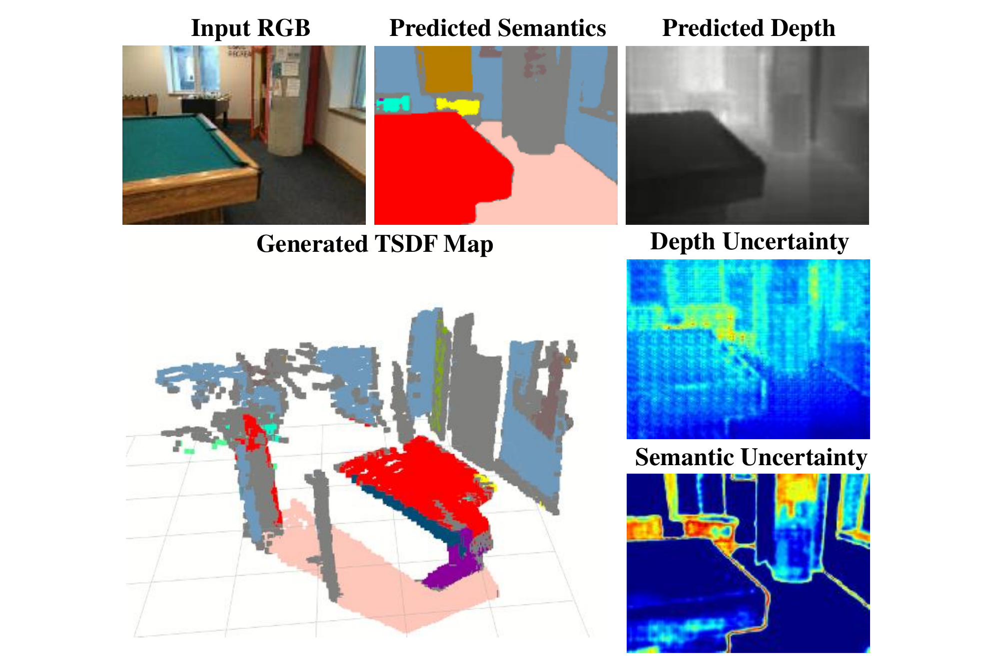
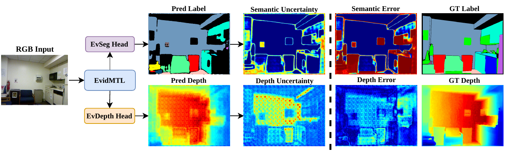
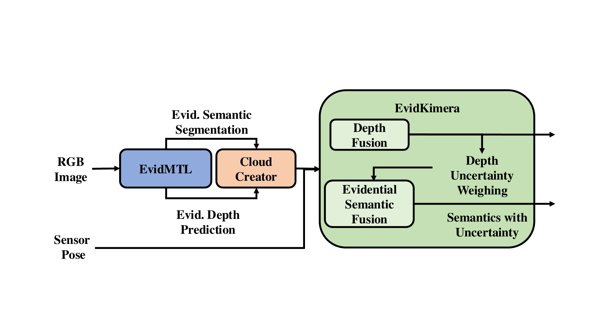
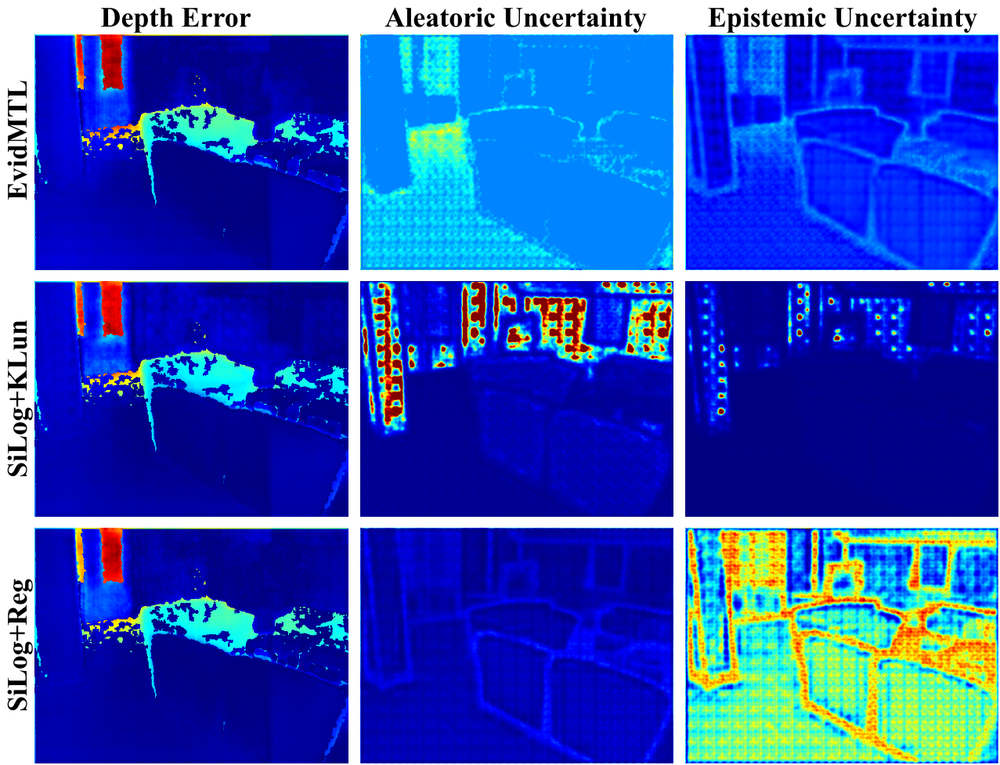

# Evidential Mapping

[](https://doi.org/10.1109/IROS60139.2025.11247528)
[](https://arxiv.org/abs/2503.04441)
[](media/menon25iros.mp4)

Code for **“EvidMTL: Evidential Multi-Task Learning for Uncertainty-Aware
Semantic Surface Mapping from Monocular RGB Images”**, by Rohit Menon, Nils
Dengler, Sicong Pan, Gokul Krishna Chenchani, and Maren Bennewitz.

<p align="center">
  
</p>

Given a monocular RGB image, EvidMTL jointly predicts semantic labels and
depth together with their uncertainties. EvidKimera uses those uncertainty
estimates to produce an uncertainty-aware semantic TSDF map.

This repository is the entry point for the EvidMTL and EvidKimera
uncertainty-aware semantic surface mapping pipeline. It pins the three public
components as Git submodules:

| Submodule | Purpose | Upstream foundation | License |
| --- | --- | --- | --- |
| [`evidmtl`](https://github.com/HumanoidsBonn/evidmtl) | Evidential semantic segmentation and monocular depth estimation | [SwinMTL](https://github.com/PardisTaghavi/SwinMTL) | GPL-3.0 |
| [`evidkimera`](https://github.com/HumanoidsBonn/evidkimera) | Uncertainty-aware semantic TSDF fusion | [Kimera-Semantics](https://github.com/MIT-SPARK/Kimera-Semantics) | BSD-2-Clause |
| [`voxblox`](https://github.com/HumanoidsBonn/voxblox) | Custom Voxblox and `voxblox_ros` support for evidential fusion | [Voxblox](https://github.com/ethz-asl/voxblox) | BSD-3-Clause |

## Video

The 39-second project video is kept as MP4 to preserve its 1080p quality while
remaining smaller than a full-length GIF. Click the preview to play it.

<p align="center">
  <a href="media/menon25iros.mp4">
    
  </a>
</p>

## What this work adds

The project introduced:

- **EvidMTL:** evidential heads for joint semantic segmentation and monocular
  depth, semantic and depth uncertainty outputs, and an evidential SiLog depth
  objective with uncertainty regularization and a Normal-Inverse-Gamma prior;
- **EvidKimera:** uncertainty-aware depth weighting, evidence-aware semantic
  fusion, voxel-level uncertainty, and viewpoint-similarity weighting for
  semantic TSDF mapping; and
- **Voxblox integration:** extended point, voxel, mesh-message, ROS conversion,
  and integrator interfaces that carry semantic evidence and depth uncertainty
  through the mapping pipeline.

These are extensions of SwinMTL, Kimera-Semantics, and Voxblox respectively;
the original projects and publications are credited below and in each
component repository.

## Method and qualitative results

### EvidMTL

EvidMTL uses a shared encoder-decoder with evidential semantic and depth heads.
The resulting uncertainty estimates are evaluated against the corresponding
prediction errors.

<p align="center">
  
</p>

### EvidKimera

EvidKimera integrates the evidential predictions into a semantic TSDF. Depth
uncertainty controls geometric fusion weights, while semantic evidence updates
the voxel semantic state and its uncertainty.

<p align="center">
  
</p>

### Out-of-distribution uncertainty

The paper evaluates zero-shot depth uncertainty on ScanNetV2 after training on
NYUDepthV2. The visualization below compares depth error, aleatoric
uncertainty, and epistemic uncertainty for EvidMTL and two ablations.

<p align="center">
  
</p>

Figures and descriptions in this section are taken from the
[arXiv paper](https://arxiv.org/abs/2503.04441).

## Clone

```bash
git clone --recurse-submodules https://github.com/HumanoidsBonn/evidential_mapping.git
```

For an existing clone:

```bash
git submodule update --init --recursive
```

## Checkpoints

The EvidMTL release uses two checkpoints:

- `silog_klmuprior_alpha1.01_gamma0.001_betacalc_final_model.ckpt`: noisy
  ground-truth mean prior;
- `silog_klmuprior_alpha2_beta0.1_gamma1.0_no_noise_final_model.ckpt`:
  ground-truth mean prior without added noise.

They are distributed separately through the
[EvidMTL Hugging Face model repository](https://huggingface.co/rohitmenon86/evidmtl).

## Citation

If you use this software, please cite our EvidMTL paper and the three
foundational papers for SwinMTL, Kimera, and Voxblox:

```bibtex
@inproceedings{menon2025evidmtl,
  author={Menon, Rohit and Dengler, Nils and Pan, Sicong and Chenchani, Gokul Krishna and Bennewitz, Maren},
  title={EvidMTL: Evidential Multi-Task Learning for Uncertainty-Aware Semantic Surface Mapping from Monocular RGB Images},
  booktitle={2025 IEEE/RSJ International Conference on Intelligent Robots and Systems (IROS)},
  year={2025},
  doi={10.1109/IROS60139.2025.11247528}
}

@inproceedings{taghavi2024swinmtl,
  author={Taghavi, Pardis and Langari, Reza and Pandey, Gaurav},
  title={SwinMTL: A Shared Architecture for Simultaneous Depth Estimation and Semantic Segmentation from Monocular Camera Images},
  booktitle={2024 IEEE/RSJ International Conference on Intelligent Robots and Systems (IROS)},
  year={2024},
  url={https://arxiv.org/abs/2403.10662}
}

@inproceedings{rosinol2020kimera,
  author={Rosinol, Antoni and Abate, Marcus and Chang, Yun and Carlone, Luca},
  title={Kimera: an Open-Source Library for Real-Time Metric-Semantic Localization and Mapping},
  booktitle={2020 IEEE International Conference on Robotics and Automation (ICRA)},
  year={2020},
  doi={10.1109/ICRA40945.2020.9196885}
}

@inproceedings{oleynikova2017voxblox,
  author={Oleynikova, Helen and Taylor, Zachary and Fehr, Marius and Nieto, Juan and Siegwart, Roland},
  title={Voxblox: Incremental 3D Euclidean Signed Distance Fields for On-Board MAV Planning},
  booktitle={2017 IEEE/RSJ International Conference on Intelligent Robots and Systems (IROS)},
  year={2017},
  doi={10.1109/IROS.2017.8202315}
}
```

The EvidMTL paper is available from
[IEEE Xplore](https://doi.org/10.1109/IROS60139.2025.11247528) and
[arXiv](https://arxiv.org/abs/2503.04441).

## Licenses

Each submodule retains its own license. See `evidmtl/LICENSE`,
`evidkimera/LICENSE.BSD`, and `voxblox/LICENSE`. The umbrella repository
does not relicense the component code.
